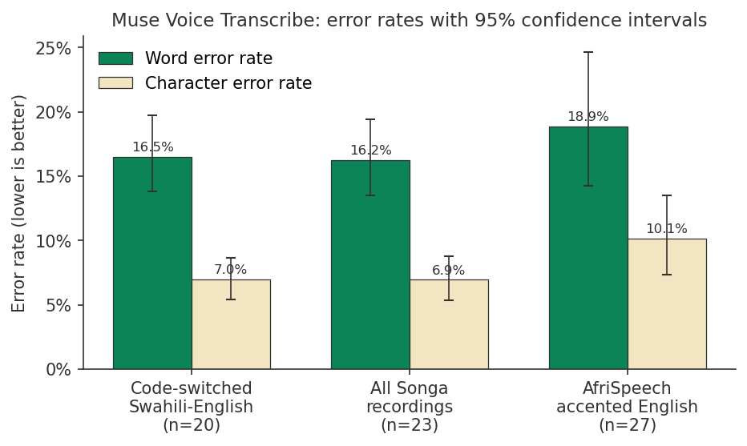
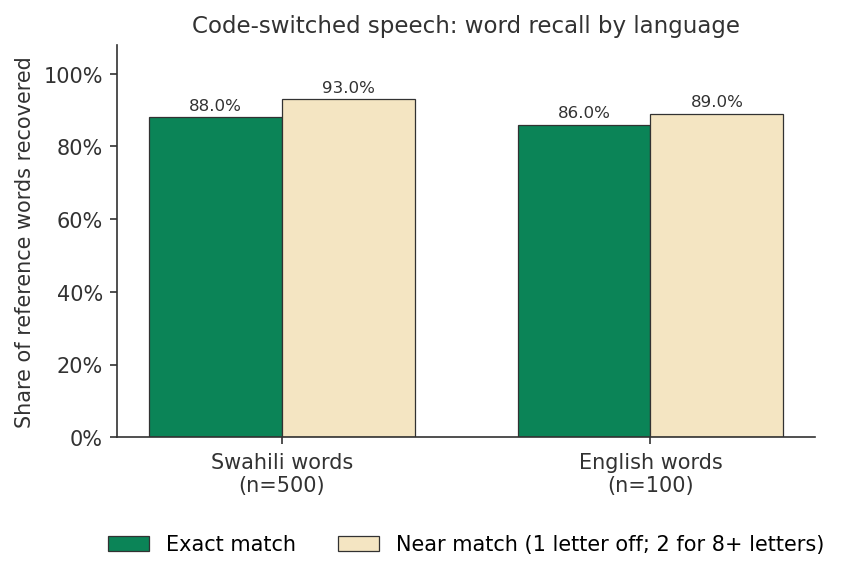
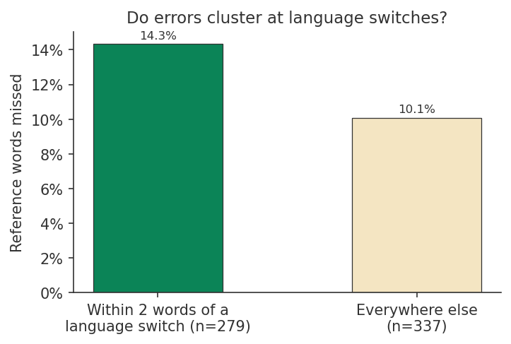
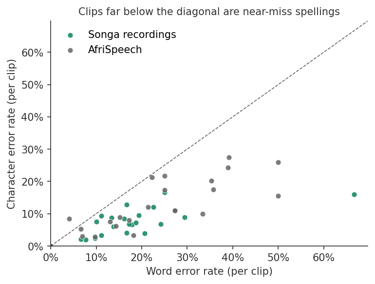
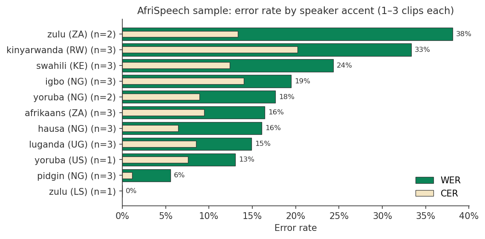
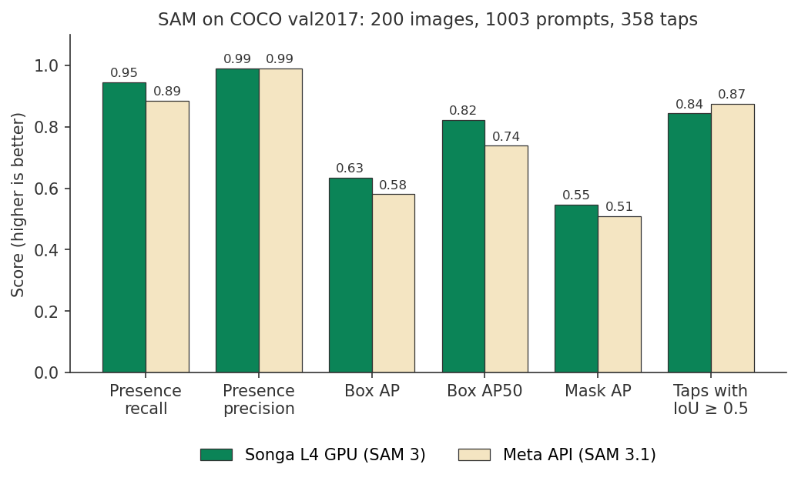
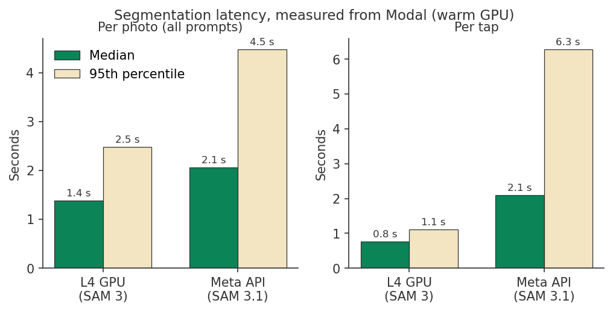
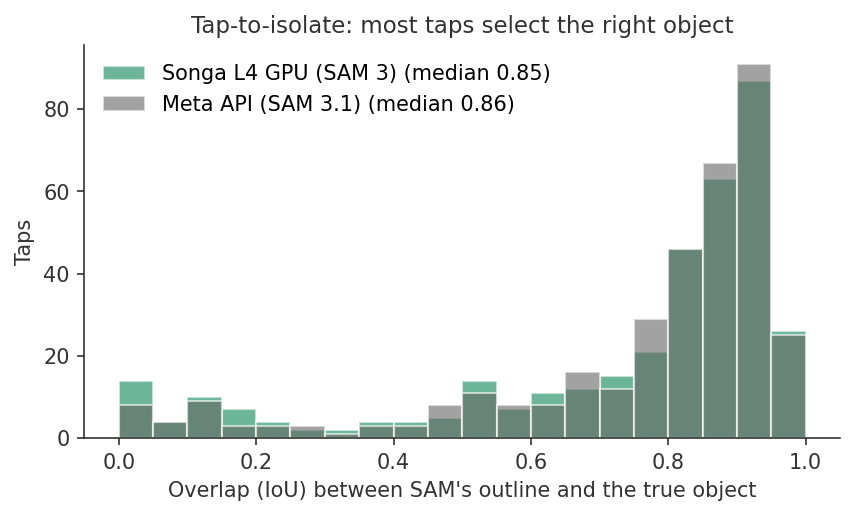

# Songa model evaluation

**Run `eval-2026-11-03`** · started 2026-11-03 21:43:40 UTC · 23.2 minutes on Modal · 50 speech clips, 200 images

Songa is a travel companion app for East Africa. It listens (Speak, Journal voice memos) and it looks (Look). This report measures the two models those features depend on:

1. **Muse Voice Transcribe** (`muse-voice-transcribe-1.0`, Meta Model API), on Kenyan Swahili-English code-switched speech and on accented African English.
2. **SAM**, comparing Songa's self-hosted SAM 3 on a Modal GPU with hosted SAM 3.1 on the Meta Model API, on a sample of COCO val2017.

A PDF version is in [`songa-evaluation.pdf`](songa-evaluation.pdf). Every number below comes from the files in [`report/eval-2026-11-03/`](report/eval-2026-11-03/). The code that produced them is in [`backend/eval_app.py`](../backend/eval_app.py) and [`backend/evals/`](../backend/evals/).

---

## Contents

1. [Key findings](#1-key-findings)
2. [Why we ran these evaluations](#2-why-we-ran-these-evaluations)
3. [Speech recognition](#3-speech-recognition)
4. [Segmentation](#4-segmentation)
5. [Limitations](#5-limitations)
6. [Conclusions and recommendations](#6-conclusions-and-recommendations)
7. [Reproducing the run](#7-reproducing-the-run)
8. [Published files](#8-published-files)
9. [Licences and attribution](#9-licences-and-attribution)
10. [Appendix: per-clip results](#appendix-a-per-clip-results-songa-recordings)

---

## 1. Key findings

**Speech (Muse Voice Transcribe)**

| Finding | Number |
|---|---|
| Word error rate on Songa's 23 recordings (616 words) | **16.2%** (95% CI 13.5–19.4%) |
| Character error rate on the same recordings | **6.9%** (95% CI 5.4–8.8%) |
| Swahili words transcribed exactly, in code-switched speech | **88.1%** of 505 (CI 85.0–91.0%) |
| Swahili words exact or within one letter (two for words of 8+ letters) | **93.1%** (CI 90.3–95.5%) |
| Swahili words that came back as an English word | **0.6%** (3 of 505) |
| Words missed within 2 words of a language switch, against elsewhere | **14.3%** vs 10.1% |
| Word error rate on 27 AfriSpeech clips of accented English (445 words) | **18.9%** (CI 14.2–24.6%) |
| Median transcription time per clip (Songa recordings, mean 16.3 s of audio) | **3.9 s** (95th percentile 5.5 s) |

Muse Voice Transcribe keeps Swahili words as Swahili. It does not translate or anglicise them, even though Kiswahili is not on its list of supported languages. The gap between word and character error rates shows that most mistakes are near-miss spellings and merged or split words, not wrong words.

**Segmentation (SAM)**

| Finding | Songa GPU (SAM 3) | Meta API (SAM 3.1) |
|---|---|---|
| Prompts for absent objects that still returned a box | 1.5% (6 of 400) | 1.25% (5 of 400) |
| Present objects found (presence recall) | **94.5%** | 88.6% |
| Box AP (COCO, IoU 0.50:0.95) | **0.634** | 0.580 |
| Mask AP | **0.546** | 0.509 |
| Taps whose outline overlaps the object by IoU ≥ 0.5 | 84.4% | **87.4%** |
| Median time per photo / per tap | **1.39 s / 0.76 s** | 2.06 s / 2.10 s |
| 95th percentile per photo / per tap | **2.48 s / 1.11 s** | 4.47 s / 6.27 s |
| Mean error in object count | 1.82 (over-counts) | **0.86** |

The self-hosted GPU finds more objects, draws better boxes and outlines, and answers faster with a much shorter tail. Hosted SAM 3.1 counts objects more accurately and isolates tapped objects slightly better. Both almost never report an object that isn't there.

---

## 2. Why we ran these evaluations

### 2.1 Speech

Speak turns what one person says into a polite rendering for the other person. Journal transcribes voice memos into a diary. Both start with Muse Voice Transcribe, and any word it gets wrong is carried into the translation or the diary.

Three things made a measurement necessary rather than optional:

- **People in Kenya code-switch.** A typical sentence mixes Swahili and English: *"Tumbo limekuwa likiniuma for three days … I feel nauseous, lakini sijatapika."* A model can do well on Swahili and on English separately and still fail at the switch points.
- **Kiswahili is not one of Muse Voice Transcribe's 25 supported languages.** Songa therefore sends no language hint for Kiswahili and lets the model detect the language. Before this run we only had anecdotes that this works.
- **The content is health information.** The recordings describe symptoms ("damu bado inapita", the bleeding hasn't stopped). Mishearing a Swahili word changes meaning, so we wanted to know specifically how often Swahili words survive. That is why the report adds Swahili-word recall to the usual word and character error rates.

We added [AfriSpeech-200](https://huggingface.co/datasets/intronhealth/afrispeech-200) as an external, public reference point: English read aloud by speakers of African languages, in clinical and general domains. It shows whether the model's accuracy on Songa's own recordings is in line with a corpus collected by someone else.

### 2.2 Segmentation

Look uses SAM to find things in a photo ("menu item", "price", "landmark") and to outline the thing a traveler taps. Songa can run SAM two ways: hosted SAM 3.1 on the Meta Model API, or the open-weights SAM 3 checkpoint on Songa's own Modal GPU (`SAM_BACKEND=modal`). Running our own GPU costs money and adds operational work, so we needed evidence on four questions:

| Question | Why it matters in Look | Metric |
|---|---|---|
| **Presence.** Does it report an object only when one is there? | A box around something that isn't there makes Songa describe a dish or sign that doesn't exist | False detections on absent objects; presence precision and recall at Songa's 0.35 threshold |
| **Detection.** Are the boxes in the right place? | Boxes are what the traveler taps | COCO box AP |
| **Segmentation.** Are the outlines right? | Outlines drive the highlight and the crop sent to Muse Wonder | COCO mask AP |
| **Tap-to-isolate.** Does a tap select the right object? | This is the main Look interaction | Mask IoU for a tap inside a known object |

Latency matters too: Look should answer while the traveler is still looking at the scene.

---

## 3. Speech recognition

### 3.1 Data

Only clips with **human-verified reference transcripts** were used.

| Set | Folder | Clips | Words | Audio | Recording |
|---|---|---|---|---|---|
| Songa recordings | `primary_collection/` | 23 | 616 | 374.1 s total, 3.5–23.0 s each (mean 16.3 s) | Kenyan speakers |
| AfriSpeech-200 sample | `samples/` | 27 | 445 | 242.9 s total, 3.2–21.0 s each (mean 9.0 s) | Corpus recordings |

**Songa recordings** (`primary_collection/metadata.csv`):

| Type | Clips | Language | Device and setting |
|---|---|---|---|
| Naturalistic health complaints | 19 | Swahili-English code-switched | Smartphone (m4a), indoor, quiet |
| Short triage phrases | 4 | 2 English, 1 Kiswahili, 1 Swahili-English | Laptop microphone (mp3), quiet |

The 19 health complaints cover 15 clinical categories, among them chest pain, breathing difficulty, paediatric fever, pregnancy bleeding, head injury, a suspected stroke in a relative, an allergic reaction and emotional distress. Each runs 3–4 sentences and switches language several times. In total the 23 clips contain 505 words tagged Swahili and 111 tagged English.

**AfriSpeech-200 sample** (`samples/metadata.csv`): 27 clips, 3 from each of 9 language groups (Afrikaans, Hausa, Igbo, Kinyarwanda, Luganda, Nigerian Pidgin, Swahili, Yoruba, Zulu). Because the corpus records the speaker's country, these become 11 accent labels: Yoruba splits into Nigeria (2) and United States (1), and Zulu into South Africa (2) and Lesotho (1). 14 clips are clinical text and 13 general text. The references are AfriSpeech's own transcripts.

#### Data cleaning (2026-11-01)

Some references in the original folder had been produced by running another transcription service and copying its output, which would measure agreement with that service instead of accuracy. We removed:

| Removed | Clips | Reason |
|---|---|---|
| WhatsApp voice notes | 15 | References were copies of another service's output |
| Clips whose reference was identical to that service's output | 26 | 25 scripted triage phrases and `sample_sw_en_backpain_explicit_negatives.m4a`. Some may have been correct, but none could be shown to be independent |
| `kelvin_sample_10.mp3` | 1 | The old CSV listed the file twice; the audio says "I am feeling much better now" but the kept reference was the Kiswahili phrase from another clip |
| Bootstrap caches and old metadata files | – | No longer needed |

A backup of everything removed is kept outside the repository. After cleaning, every remaining reference is marked `human (verified)` in its metadata.

### 3.2 Method

#### Request path

Each clip went through Songa's production adapter (`MetaVoiceTranscriber`), exactly as a Speak or Journal request does:

1. ffmpeg converts the clip to mono 16-bit PCM WAV at 24 kHz (Voice Transcribe accepts WAV only).
2. The WAV is sent to `POST /v1/asr/transcribe` with model `muse-voice-transcribe-1.0`.
3. Language hint, as in the app: `en` for English clips and all AfriSpeech clips; **no hint** for Kiswahili and Swahili-English clips.

Three clips were transcribed at a time. A failed request was retried up to 4 times; no clip failed. Latency is measured per request from the moment the request gets one of the three slots, so it does not include time spent queueing. It includes the ffmpeg conversion and the network round trip from Modal to the Meta API.

#### Text normalisation

Reference and transcript are normalised the same way before scoring (`evals/asr_metrics.py::normalize`):

1. Unicode NFKC, then lowercase.
2. AfriSpeech only: spoken punctuation ("comma", "full stop", "colon", "new line" and 17 others) is removed from the transcript, but only when the reference does not contain that word. AfriSpeech readers say punctuation aloud and the model, correctly, writes it down.
3. Digits are spelled out with `num2words` ("21" becomes "twenty one").
4. Hyphens become spaces; all other punctuation is removed; apostrophes are deleted.
5. Whitespace is collapsed.

Normalisation matters. The mean per-clip WER before normalisation was 26.3% on Songa recordings and 44.3% on AfriSpeech, against 17.2% and 19.8% after. The unnormalised values are kept in `asr_per_clip.jsonl` (`wer_unnormalized`).

#### Metrics

All rates are **pooled**: total errors over total reference words (or characters) across the set, so long clips weigh more than short ones.

| Metric | Definition |
|---|---|
| **WER** | (S + D + I) / N, where S, D and I are word substitutions, deletions and insertions from a minimum-edit alignment (jiwer), and N is the number of reference words |
| **CER** | The same over characters of the normalised text, spaces included. It is fairer than WER to long agglutinative Swahili words, where one wrong letter makes the whole word wrong |
| **Swahili recall (strict)** | Share of Swahili reference words that the alignment marks as an exact match |
| **Swahili recall (lenient)** | Share of Swahili reference words that are an exact match or a substitution within Levenshtein distance 1 (distance 2 for words of 8 or more letters) |
| **Swahili→English** | Share of Swahili reference words substituted by a word the tagger classes as English |
| **English recall** | Strict and lenient, as above, for English reference words |
| **Error near switches** | Share of reference words, within 2 positions of a Swahili↔English boundary, that were not transcribed exactly |

**Word language tags.** Each reference word in a code-switched clip is tagged Swahili or English (`WordTagger`). There is no Swahili word-frequency list in `wordfreq`, so a word counts as English if its English Zipf frequency is at least 2.5 and it is not on a list of 68 common Swahili words that also occur in English text (for example "na", "ni", "kama", "homa", "mama"); every other word counts as Swahili. All words in English-only and AfriSpeech clips count as English. The tagger was spot-checked against the 350 distinct words in this dataset. Borrowed words ("daktari", "insulin") can land on either side, so the Swahili/English split is approximate.

**Switch window.** For every boundary between a Swahili word and an English word in the reference, the two words before and the two words after the boundary are in the window. 279 of the 616 words fall in a window.

**Confidence intervals.** 95% intervals come from a bootstrap over clips: 1,000 resamples of whole clips with replacement (seed 7), recomputing the pooled metric each time and taking the 2.5th and 97.5th percentiles. Resampling clips rather than words accounts for the fact that words in one recording share a speaker and conditions. Intervals are reported for sets of 5 or more clips.

### 3.3 Results

| Set | Clips | Words | WER | CER | Swahili recall strict | Swahili recall lenient | Swahili→English | English recall strict / lenient | Error near switches | Latency p50 / p95 |
|---|---|---|---|---|---|---|---|---|---|---|
| All Songa recordings | 23 | 616 | **16.2%** (13.5–19.4) | **6.9%** (5.4–8.8) | **88.1%** (85.0–91.0) | **93.1%** (90.3–95.5) | 0.6% | 87.4% (76.9–94.4) / 90.1% | 14.3% | 3.90 / 5.47 s |
| Code-switched only | 20 | 600 | 16.5% (13.8–19.7) | 7.0% (5.4–8.6) | 88.0% (84.8–90.9) | 93.0% (90.1–95.6) | 0.6% | 86.0% (75.5–94.1) / 89.0% | 14.3% | 3.92 / 5.53 s |
| English phrases | 2 | 11 | 9.1% | 7.1% | – | – | – | 100% / 100% | – | 1.38 / 1.44 s |
| Kiswahili phrase | 1 | 5 | 0.0% | 0.0% | 100% | 100% | 0% | – | – | 1.56 s |
| AfriSpeech (accented English) | 27 | 445 | **18.9%** (14.2–24.6) | **10.1%** (7.3–13.5) | – | – | – | 86.5% (81.4–90.3) / 89.7% | – | 2.01 / 3.41 s |

By recording type, the 19 naturalistic health complaints (597 words) have a WER of 16.3% and the 4 triage phrases (19 words) 15.8%.



*Figure 1. Word and character error rates for code-switched recordings, all Songa recordings and the AfriSpeech sample. Error bars are 95% bootstrap confidence intervals over clips. The intervals for Songa recordings and AfriSpeech overlap, so the two sets cannot be said to differ.*

#### Are Swahili words captured in code-switched speech?

Yes, for the large majority. Of the 500 Swahili words in the 20 code-switched clips, 88.0% came back exactly and 93.0% exactly or within a letter. Only 3 Swahili words were replaced by an English word. Across all 505 Swahili words, the 60 misses break down as 25 near-miss spellings, 30 substitutions by a different word and 5 deletions. English words inside the same sentences did about as well (86.0% exact), so neither language is favoured.



*Figure 2. Share of Swahili and English reference words recovered in the 20 code-switched clips, exactly (green) and within one letter, or two for words of 8+ letters (cream).*

#### Do errors cluster at language switches?

Somewhat. 14.3% of the 279 words near a switch were not transcribed exactly, against 10.1% of the other 337 words, about 1.4 times as often. This is a descriptive comparison with no confidence interval; the same speakers and clips contribute to both groups.



*Figure 3. Share of reference words not transcribed exactly, within 2 words of a Swahili↔English switch and elsewhere, in Songa recordings.*

#### Word errors against character errors

All but one of the clips with errors lie below the diagonal in Figure 4: the character error rate is much lower than the word error rate, so most wrong words are close to the right word. The exception is an AfriSpeech clip with 4% WER and 8% CER. For Songa recordings, the pooled CER (6.9%) is less than half the WER (16.2%).



*Figure 4. Word error rate against character error rate for each of the 50 clips. The dashed line is WER = CER. The outlier at 67% WER is the 3-word phrase "Naweza kubook appointment?".*

#### AfriSpeech by accent

| Accent | Clips | Words | WER | CER |
|---|---|---|---|---|
| zulu (LS) | 1 | 10 | 0.0% | 0.0% |
| pidgin (NG) | 3 | 36 | 5.6% | 1.2% |
| yoruba (US) | 1 | 23 | 13.0% | 7.6% |
| luganda (UG) | 3 | 47 | 14.9% | 8.5% |
| hausa (NG) | 3 | 56 | 16.1% | 6.4% |
| afrikaans (ZA) | 3 | 73 | 16.4% | 9.4% |
| yoruba (NG) | 2 | 17 | 17.6% | 8.9% |
| igbo (NG) | 3 | 77 | 19.5% | 14.0% |
| swahili (KE) | 3 | 37 | 24.3% | 12.4% |
| kinyarwanda (RW) | 3 | 48 | 33.3% | 20.2% |
| zulu (ZA) | 2 | 21 | 38.1% | 13.3% |

By domain: clinical text 18.0% WER (206 words, 14 clips), general text 19.7% (239 words, 13 clips).



*Figure 5. AfriSpeech WER and CER by speaker accent. Each accent has only 1–3 clips (10–77 words), so the ranking is not reliable; a single misheard phrase moves an accent by 5–10 points.*

### 3.4 Error analysis

The per-clip file `asr_per_clip.jsonl` holds every reference, transcript and aligned substitution. The patterns below were read from it.

| Pattern | Example (reference → transcript) | Effect |
|---|---|---|
| **Swahili word boundaries** | "ni tangu juzi" → "nitangujuzi"; "tangu usiku" → "tangusiku" | One merge costs several word errors but few character errors |
| **Dropped or changed prefixes** | "natokwa" → "tokwa"; "naona" → "ona"; "kazini" → "kazi"; "tangu" → "tangwa" | Counted as near misses in lenient recall when within a letter or two |
| **Swahili affix on an English stem** | "Naweza kubook appointment?" → "Naweza kubuka pointment." | The hardest code-switch, inside one word. 2 of 3 words wrong (67% WER, 16% CER) |
| **Translation instead of transcription** | "Amekuwa na fever" → "… na homa" | The model wrote the Swahili word for an English word the speaker said. Seen once |
| **Script leak** | "kichwa" → "kiचwa" | One Devanagari character inside a Swahili word. Seen once in 23 clips |
| **English words heard as Swahili-like** | "burning" → "baning"; "mostly" → "musli"; "stairs" → "stea" | Kenyan pronunciation of English loan words |
| **Numbers and dates (AfriSpeech)** | "21/22/20" → "twenty fourth twenty second twenty"; "28 April, 1998" → "twenty-eighth April …" | Ordinals and formatting, not mishearing |
| **Rare technical words (AfriSpeech)** | "hyaline degeneration" → "high line degeneration"; "paucity" → "first" | Domain vocabulary |

On Songa recordings, 30 of the substitutions hit Swahili reference words (5.9% of 505) and 10 hit English reference words (9.0% of 111).

The six clips with the highest WER:

| Clip | Set | WER | CER | Reference | Transcript |
|---|---|---|---|---|---|
| `kelvin_sample_30.mp3` | Songa | 66.7% | 16.0% | Naweza kubook appointment? | Naweza kubuka pointment. |
| `afrispeech_ha_2.wav` | Hausa | 50.0% | 26.0% | PULMONARY WEDGE { a/v/m } 21/22/20 | pulmonary wedge EVM twenty fourth twenty second twenty |
| `afrispeech_zu_2.wav` | Zulu (ZA) | 50.0% | 15.6% | Dense old scars may undergo hyaline degeneration and subsequent calcification. | fans all discards may undergo high line degeneration and subsequent calcification. |
| `afrispeech_ig_2.wav` | Igbo | 39.1% | 27.5% | Tuesday 28 April, 1998 next line. Neuro: Pt Daramola Achike 08 February, 2003 | tuesday twenty-eighth April comma nineteen ninety-eight next next line full stop neuro colon patient Daramola Achike zero eight February comma two thousand and three. |
| `afrispeech_rw_0.wav` | Kinyarwanda | 38.9% | 24.3% | Apart from the paucity of funding and insecurity in parts of the country, successive governments fail to perform. | apart from the first funding and security in terms of the successive government, first to perform. |
| `afrispeech_rw_2.wav` | Kinyarwanda | 35.7% | 17.4% | All of them, especially the phalanges, are slightly concave on the inferior plantar side. | all of them come up, especially the phalanges comma a slightly concave on the imperial planter side period. |

Among the health complaints, the highest WER was 29.4% (abdominal pain) and the lowest 6.7% (fever and headache). Six of the 23 Songa clips scored 10% WER or better. The full list is in [Appendix A](#appendix-a-per-clip-results-songa-recordings).

#### Latency

Median transcription time was 3.9 s for Songa recordings (mean 16.3 s of audio) and 2.0 s for AfriSpeech (mean 9.0 s of audio). Short triage phrases took 1.2–1.6 s. Time grows with clip length, at roughly a quarter of the audio duration for the longer health complaints. In the app, Speak shows the transcript as soon as it arrives, before the translation is ready.

---

## 4. Segmentation

### 4.1 Data

COCO val2017 with the official instance annotations from `images.cocodataset.org`, downloaded inside the run.

| Item | Value |
|---|---|
| Images | 200, sampled with seed 7 from val2017 images that have at least one non-crowd object |
| Prompts | 1,003: every category present in each image (603 prompts) plus 2 randomly chosen categories that are absent (400 prompts) |
| Prompt text | The COCO category name, for example "dining table", "traffic light", "sports ball" |
| Taps | 358: up to 2 per image, chosen at random among non-crowd objects of at least 32 × 32 px (1,024 px²); some images had fewer than 2 eligible objects |
| Tap point | The pixel deepest inside the object's mask (maximum of the Euclidean distance transform), so the tap lands clearly on the object rather than at its edge |

Both backends received identical JPEG bytes (quality 90) at COCO's original resolution, so their coordinates line up with the annotations.

We chose COCO over SA-Co/Gold, the benchmark released with SAM 3, because SA-Co/Gold's images need a separate download from Roboflow, while COCO's are public URLs. COCO's simple object names make absolute scores easier than real travel scenes (Section 5).

### 4.2 Systems under test

| | Songa GPU | Meta API |
|---|---|---|
| Model | SAM 3, `facebook/sam3` via Hugging Face transformers | SAM 3.1, `sam-3.1`, hosted |
| Code path | `Sam3Runner`, the same code as production `SamGpu`, in a separate `EvalSam` class so the live app was never touched | Songa's `MetaSamSegmenter` adapter, called with confidence scores and one-bit masks |
| Hardware | One Modal GPU container: L4 requested, A10 allowed as fallback (the log does not record which served), up to 4 concurrent inputs | Meta's servers, over the network from Modal |
| Text prompts per photo | One call with all of the photo's prompts, internal score floor 0.05 | One request per prompt, 4 at a time, as Look does; no score threshold |
| Taps | Point prompt, 4 taps in flight sharing the one GPU | Point prompt, 4 taps in flight |

For both backends, duplicate boxes were removed per prompt with greedy non-maximum suppression at box IoU 0.6, the same cut-off as Songa's `refine_segments`. Detections were otherwise kept at every score, so the AP computation sees the whole precision-recall curve. If the Meta API returned a detection without a confidence score, it was scored 1.0.

**Warm-up.** Before anything was timed, one request booted the GPU container and loaded the weights. This took 2 min 35 s in this run (the evaluation class has no memory snapshot). Production `SamGpu` uses a GPU memory snapshot and starts in about 6 s, and Look falls back to the Meta API until the GPU answers. Cold starts are excluded from every latency below.

### 4.3 Metrics

| Metric | Definition |
|---|---|
| **Presence** | A prompt counts as "reported present" when its highest-scoring detection is at or above **0.35**, Songa's production `SAM_SCORE_THRESHOLD`. Precision = TP / (TP + FP), recall = TP / (TP + FN) over the 1,003 prompts |
| **False detections on absent objects** | FP / (FP + TN) over the 400 absent-object prompts |
| **Count error** | Mean of \|detections ≥ 0.35 − true non-crowd instances\| over present prompts |
| **Box AP / Mask AP** | Standard COCO average precision from `pycocotools` `COCOeval`, restricted to the 200 sampled images. AP averages IoU thresholds 0.50 to 0.95; AP50 and AP75 use one threshold; AR100 is recall with up to 100 detections per image. Detections returned for absent-object prompts count as false positives |
| **Tap IoU** | Intersection over union between the returned mask and the tapped object's ground-truth mask. An empty answer scores 0 |
| **Latency per photo** | Wall time from the first prompt request to the last answer for that photo. Photos ran one after another |
| **Latency per tap** | Wall time of one tap request, measured from when it gets one of the 4 slots |

### 4.4 Results

| | Songa GPU (SAM 3) | Meta API (SAM 3.1) |
|---|---|---|
| Failed prompts / taps | 0 / 0 | 0 / 0 |
| True positives / false negatives (603 present) | 570 / 33 | 534 / 69 |
| False positives / true negatives (400 absent) | 6 / 394 | 5 / 395 |
| **False detections on absent objects** | 1.5% | **1.25%** |
| **Presence precision** | 99.0% | **99.1%** |
| **Presence recall** | **94.5%** | 88.6% |
| Presence accuracy | **96.1%** | 92.6% |
| Mean count error | 1.82 | **0.86** |
| **Box AP** / AP50 / AP75 / AR100 | **0.634** / 0.822 / 0.682 / 0.737 | 0.580 / 0.739 / 0.631 / 0.618 |
| **Mask AP** / AP50 / AP75 / AR100 | **0.546** / 0.809 / 0.597 / 0.638 | 0.509 / 0.733 / 0.569 / 0.550 |
| **Tap mean IoU** / median | 0.735 / 0.846 | **0.762** / **0.855** |
| Taps with IoU ≥ 0.5 / ≥ 0.75 | 84.4% / 67.9% | **87.4%** / **72.1%** |
| Taps with IoU < 0.1 | 18 | **12** |
| **Latency per photo** p50 / p95 / mean | **1.39 / 2.48 / 1.54 s** | 2.06 / 4.47 / 2.38 s |
| **Latency per tap** p50 / p95 / mean | **0.76 / 1.11 / 0.83 s** | 2.10 / 6.27 / 2.57 s |



*Figure 6. Presence recall and precision at the 0.35 threshold, COCO box AP, AP50 and mask AP, and the share of taps with IoU ≥ 0.5, for Songa's GPU (green) and the Meta API (cream). Higher is better.*



*Figure 7. Median and 95th-percentile latency per photo (all of a photo's prompts) and per tap, measured from Modal with a warm GPU.*



*Figure 8. Distribution of IoU between SAM's outline and the tapped object, for the 358 taps on each backend. Most taps land between 0.8 and 1.0; the small peak near 0 is most likely taps that selected a different object or only part of one.*

### 4.5 Error analysis

**Presence.** Both backends almost never invent objects: 6 and 5 false detections in 400 absent prompts, mostly on the same categories (bus, sandwich, potted plant, dining table, chair). We did not inspect these images. Some may show objects that COCO did not annotate. The two backends differ in what they miss. The GPU missed 33 present objects and Meta 69. "Dining table" was missed most often by both (4 times on the GPU, 9 on Meta), probably because tables are often partly hidden under food and dishes. Meta also missed "person" 4 times, and "truck" and "knife" 4 times each.

**Counting.** The GPU tends to over-count: it reported more instances than exist on 269 of 603 present prompts and fewer on 47. Meta over-counted on 108 and under-counted on 128. In crowded scenes (88 prompts with 5 or more instances), the mean count error was 6.6 on the GPU and 2.9 on Meta. For Look, this means the GPU draws more boxes than there are objects, some of them parts or near-duplicates that survive non-maximum suppression at IoU 0.6.

**AP.** The GPU's higher AR100 (0.737 against 0.618) shows it returns more correct candidates overall, which is most of its AP lead. The Meta API may filter low-confidence detections before returning them, which limits the recall AP can reach, so part of the AP gap may come from the API's output rather than the model.

**Taps.** On 330 of the 358 taps the two backends' IoU was within 0.1 of each other. Meta was better by more than 0.1 on 20 taps, the GPU on 8. Low-IoU taps (below 0.5) were most often on people (10 on the GPU, 4 on Meta), chairs and beds, where a point can mean a part (a shirt, a cushion) or the whole object.

**Latency.** The GPU is faster at the median and much faster in the tail: Meta's 95th percentile per tap is 6.3 s against 1.1 s. GPU tap latency was measured with 4 taps sharing one GPU, so a single traveler's tap would likely be quicker.

---

## 5. Limitations

**Speech**

- **Small sample.** 23 Songa clips (616 words) and 27 AfriSpeech clips (445 words). The confidence intervals are 5–10 points wide. Per-accent and per-language-pair rows with 1–3 clips are anecdotes.
- **Few speakers.** The metadata does not record speaker IDs. The Songa recordings come from a small number of Kenyan speakers, in quiet rooms. Street noise, phone codecs on calls and other dialects (Sheng, coastal Swahili) are not covered.
- **Scripted content.** The health complaints were written to sound natural and then read aloud. Spontaneous speech has more hesitation and self-correction.
- **Approximate language tags.** The Swahili/English split uses English word frequency plus a 68-word override list. Borrowed words can be tagged either way, which affects the Swahili recall and switch-window metrics but not WER or CER.
- **Run-to-run variance.** An earlier run on the same AfriSpeech clips, stopped before it finished, measured 14.6% WER against 18.9% here. Both lie inside this run's interval. The API's output for a clip is not guaranteed to be identical across calls; repeated runs would give a firmer number.
- **AfriSpeech sample selection.** The 27 clips are three per language group. The script that selected them is not part of this repository, so they should not be treated as a random sample of the corpus.
- **No end-to-end measure.** This run measures transcription only. It does not measure whether Speak's final translation kept the speaker's intent.

**Segmentation**

- **COCO is easier than travel scenes.** COCO uses 80 everyday object names. Look asks for concepts like "menu item", "price" or "street sign" in cluttered, often text-heavy photos. Absolute scores here are optimistic; the comparison between backends is the useful part.
- **Not the same model.** The GPU runs SAM 3 and the API runs SAM 3.1, through different post-processing. The comparison is between Songa's two deployment options, not a controlled model ablation.
- **Different request patterns.** The GPU gets one batched call per photo; the API gets one call per prompt (about 5 per photo), as Look sends them. Per-photo latency reflects each path as Songa uses it.
- **Latency from Modal.** Meta latency includes the network from Modal to the Meta API; GPU latency includes Modal's call overhead. A phone adds its own network time to both. Latency was measured once, at one time of day.
- **GPU type not logged.** The evaluation class accepts an L4 or an A10; the run did not record which one it got.
- **No error bars.** The segmentation metrics have no confidence intervals. With 200 images, differences of a few AP points should be read with care.

---

## 6. Conclusions and recommendations

**Speech.** Muse Voice Transcribe is good enough for Songa's code-switched Swahili-English use without a language hint. It recovers 88% of Swahili words exactly and 93% within a letter, and turns almost none into English words. Most errors are spelling and word-boundary problems. A downstream language model such as Muse Wonder may be able to read through them, but this run did not measure that. Errors rise somewhat at language switches and are worst when a Swahili prefix is attached to an English word ("kubook").

Recommended next steps:

1. Grow the speech set to at least 100 clips from 10 or more speakers, including noisy outdoor recordings and spontaneous speech.
2. Add an end-to-end check: does Speak's translation keep the meaning of what was said, even when the transcript has errors?
3. Strip non-Latin characters from transcripts when the expected languages use Latin script (the "kiचwa" case).
4. Repeat runs to measure the run-to-run variance of the API.

**Segmentation.** The self-hosted SAM 3 GPU is the better default for Look's detection: higher recall (94.5% against 88.6%), higher box and mask AP, a median photo latency of 1.4 s and a 95th percentile under 2.5 s. Hosted SAM 3.1 is slightly better at tap-to-isolate and counts objects more accurately. Both have very low false-detection rates at the 0.35 threshold. This supports Songa's current design: `SAM_BACKEND=modal` with hosted SAM 3.1 as the fallback while the GPU boots.

Recommended next steps:

1. Reduce GPU over-counting: try stricter duplicate suppression, or a higher threshold for counts than for presence.
2. Evaluate on travel photos (menus, signs, markets) with concept prompts, for example SA-Co/Gold or a small Songa-labelled set.
3. Weigh cost: the GPU bills while it is up (about $19 per day if kept always on with `SONGA_SAM_WARM=1`; it normally shuts down after 3 idle minutes).

---

## 7. Reproducing the run

Everything runs on Modal. Prerequisites: a Modal account, the `songa-secrets` secret with `META_API_KEY` and an `HF_TOKEN` that has access to `facebook/sam3` (see the [root README](../README.md#backend-setup-modal)), and the audio files in `primary_collection/` and `samples/` (the audio is not in the repository; see Section 9).

From `backend/`:

```bash
modal deploy eval_app.py                          # once, and again after changing the code or the data
modal run eval_app.py                             # full run (speech + segmentation); returns at once
modal run eval_app.py --parts asr                 # speech only
modal run eval_app.py --limit 4 --run-id smoke    # quick smoke test
modal app logs songa-eval                         # live progress
```

`modal run eval_app.py` spawns `run_eval` on the deployed app, so the run continues after the terminal closes or the computer shuts down. (A `.remote()` call with `modal run --detach` is not enough: Modal cancels it when the local client disconnects.) Options: `--images` (default 200), `--seed` (default 7), `--run-id` (default: UTC timestamp).

When it finishes, download the run and draw the figures:

```bash
mkdir ../Evaluation/results                                        # the folder must exist
modal volume get songa-eval results/<run_id> ../Evaluation/results
pip install matplotlib
python -m evals.report ../Evaluation/results/<run_id>              # writes figures/ and analysis.json
```

To turn this report into a PDF (from the repository root; needs pandoc and Google Chrome, no LaTeX):

```powershell
pandoc Evaluation/README.md -f gfm -s --self-contained --metadata title="Songa model evaluation" `
  --resource-path=Evaluation --css Evaluation/pdf.css -o "$env:TEMP\songa-evaluation.html"
& "$env:ProgramFiles\Google\Chrome\Application\chrome.exe" --headless=new --no-pdf-header-footer `
  --print-to-pdf="$PWD\Evaluation\songa-evaluation.pdf" "$env:TEMP\songa-evaluation.html"
```

**Cost of this run:** 23.2 minutes of wall time, and $0.94 of Modal usage (CPU orchestration plus one GPU), which Modal's free credits covered. Meta Model API usage is billed separately by Meta and was not measured here.

**Timeline of this run (UTC):** speech evaluation 21:43:40–21:44:32 (52 s for 50 clips); GPU warm-up 21:44:44–21:47:19; GPU photos and taps 21:47:19–21:54:17; Meta API photos and taps from 21:54:23 to the end of the run.

**Code map**

| File | Role |
|---|---|
| `backend/eval_app.py` | Modal app `songa-eval`: image, `EvalSam` GPU class, `run_eval` function (3 h timeout), `songa-eval` results Volume |
| `backend/evals/runner.py` | Loads clips, calls both models, writes results and `summary.md` |
| `backend/evals/asr_metrics.py` | Normalisation, word tagger, WER, CER, recall, switch window, bootstrap |
| `backend/evals/seg_eval.py` | COCO sampling, tap points, presence, AP and tap metrics |
| `backend/evals/report.py` | Figures and `analysis.json`, from the run files only (no API calls) |

---

## 8. Published files

[`report/eval-2026-11-03/`](report/eval-2026-11-03/) holds the published copy of this run.

| File | Contents |
|---|---|
| `summary.md` | The run's own summary tables |
| `results.json` | Every aggregate metric, overall and by group, with confidence intervals |
| `analysis.json` | Switch effect, substitutions, worst clips, most-missed categories, false detections, tap head-to-head |
| `asr_per_clip.jsonl` | One line per clip: reference, transcript, normalised texts, scores, substitutions, latency |
| `seg_prompts.jsonl` | One line per backend, image and prompt: present or absent, true count, detections, top score |
| `seg_taps.jsonl` | One line per backend and tap: image, category, point, IoU, latency |
| `config.json`, `run.log` | Run parameters and the progress log |
| `figures/` | Figures 1–8 used in this report (PNG, 150 dpi) |

The raw detections (`seg_detections_*.json`, 7 MB) are not published; they can be regenerated with the run.

---

## 9. Licences and attribution

- **AfriSpeech-200** clips and transcripts are © Intron Health, licensed [CC BY-NC-SA 4.0](https://creativecommons.org/licenses/by-nc-sa/4.0/). The AfriSpeech transcripts and model outputs in `samples/metadata.csv` and `asr_per_clip.jsonl` are shared under the same licence, for non-commercial use. The audio is not in this repository; get it from the [dataset page](https://huggingface.co/datasets/intronhealth/afrispeech-200).
- **Songa recordings.** The audio stays out of the repository (`.gitignore` excludes all `.wav`, `.mp3`, `.m4a` and `.ogg` files under `Evaluation/`). The reference transcripts are in `primary_collection/metadata.csv`.
- **COCO** annotations are licensed CC BY 4.0 by the COCO Consortium; the images belong to their Flickr owners and are not redistributed here.
- **SAM 3** weights (`facebook/sam3`) are distributed by Meta under the SAM License on Hugging Face. **SAM 3.1**, **Muse Voice Transcribe** and **Muse Wonder** are used through the Meta Model API under its terms.

---

## Appendix A. Per-clip results, Songa recordings

Sorted by WER. Latency is the transcription request time.

| Clip | Type | Language | WER | CER | Latency |
|---|---|---|---|---|---|
| `kelvin_sample_13.mp3` | Triage phrase | English | 0.0% | 0.0% | 1.31 s |
| `kelvin_sample_23.mp3` | Triage phrase | Kiswahili | 0.0% | 0.0% | 1.56 s |
| `sample_sw_en_fever_and_headache.m4a` | Health complaint | Swahili-English | 6.7% | 2.2% | 3.93 s |
| `sample_sw_en_emotinal_distress.m4a` | Health complaint | Swahili-English | 7.7% | 2.0% | 5.09 s |
| `sample_sw_en_eye_exposure.m4a` | Health complaint | Swahili-English | 9.7% | 2.5% | 4.00 s |
| `sample_sw_en_diarrhoea_vomiting.m4a` | Health complaint | Swahili-English | 10.0% | 7.5% | 4.38 s |
| `sample_sw_en_child_described.m4a` | Health complaint | Swahili-English | 11.1% | 9.3% | 6.09 s |
| `sample_sw_en_sudden_change_relative.m4a` | Health complaint | Swahili-English | 11.1% | 3.3% | 4.72 s |
| `sample_sw_en_pain_urinating.m4a` | Health complaint | Swahili-English | 13.3% | 8.8% | 3.87 s |
| `sample_sw_en_injury_ongoning_bleeding.m4a` | Health complaint | Swahili-English | 13.8% | 6.1% | 3.90 s |
| `sample_sw_en_chest_discomfort.m4a` | Health complaint | Swahili-English | 16.1% | 8.5% | 5.26 s |
| `kelvin_sample_19.mp3` | Triage phrase | English | 16.7% | 12.9% | 1.44 s |
| `sample_sw_en_diabetes_missed_food.m4a` | Health complaint | Swahili-English | 16.7% | 4.1% | 3.94 s |
| `sample_sw_en_Persisent_cough.m4a` | Health complaint | Swahili-English | 17.2% | 6.7% | 3.90 s |
| `sample_sw_en_head_injury_uncertainity.m4a` | Health complaint | Swahili-English | 17.9% | 6.7% | 3.76 s |
| `sample_sw_en_pregancy_bleeding.m4a` | Health complaint | Swahili-English | 18.8% | 7.2% | 3.52 s |
| `sample_sw_en_medication-refill.m4a` | Health complaint | Swahili-English | 19.4% | 9.6% | 3.29 s |
| `sample_sw_en_mild_respiratory_symptoms.m4a` | Health complaint | Swahili-English | 20.7% | 3.9% | 3.33 s |
| `sample_sw_en_Symptoms_after_taking_meds.m4a` | Health complaint | Swahili-English | 22.6% | 12.1% | 3.91 s |
| `sample_sw_en_dental_pain_swelling.m4a` | Health complaint | Swahili-English | 24.1% | 6.8% | 3.41 s |
| `sample_sw_en_difficulty_breathing.m4a` | Health complaint | Swahili-English | 25.0% | 16.6% | 4.10 s |
| `sample_sw_en_adbominal_pain.m4a` | Health complaint | Swahili-English | 29.4% | 9.0% | 5.50 s |
| `kelvin_sample_30.mp3` | Triage phrase | Swahili-English | 66.7% | 16.0% | 1.20 s |

File names keep their original spelling so they match the metadata.
