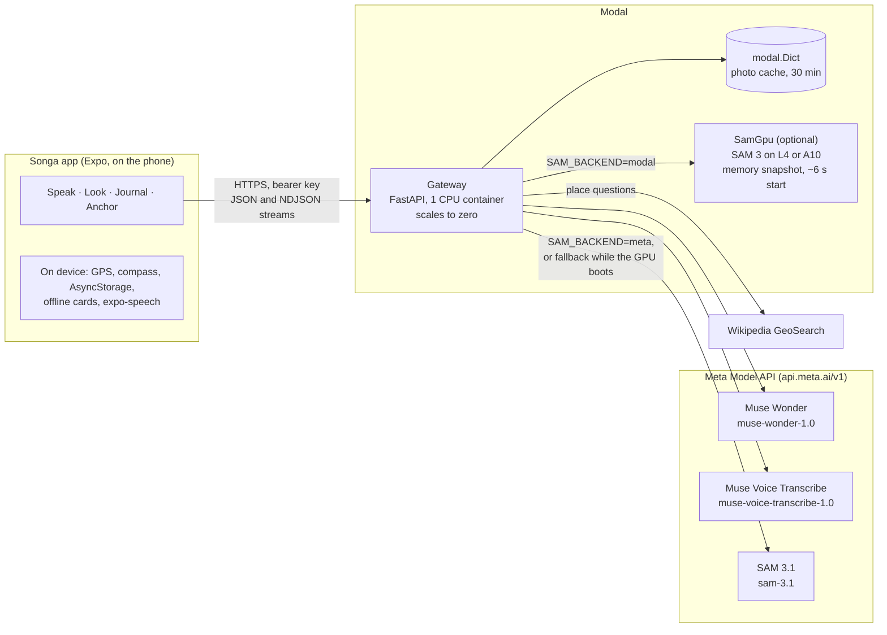
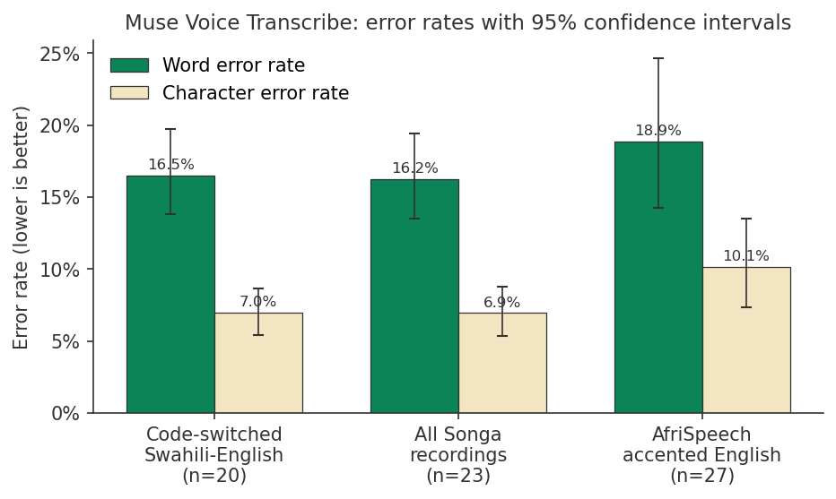
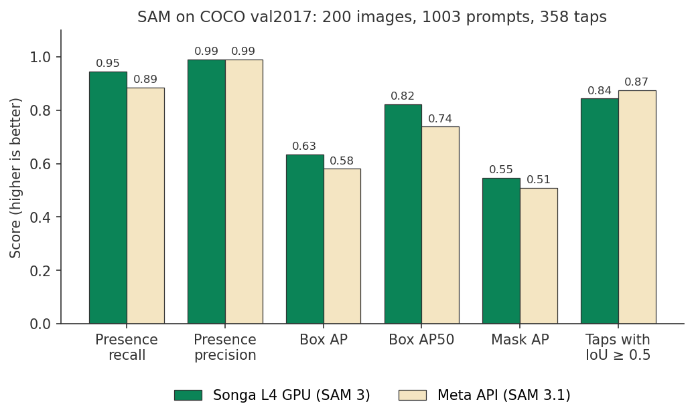

# Songa

Songa is a context-aware travel companion. It breaks language barriers with intent-driven voice interpretation, explains what the camera sees with tap-to-explain vision built on SAM, writes your day into a first-person diary, and points you back to your lodging with no network.

Songa runs on Meta's models through the Meta Model API: **Muse Wonder** for language and vision reasoning, **SAM 3.1** for segmentation and **Muse Voice Transcribe** for speech. Segmentation can also run on Songa's own GPU with the open-weights **SAM 3** checkpoint.

We evaluated both the speech and the segmentation models. The full report, with method, figures and limitations, is in [`Evaluation/README.md`](Evaluation/README.md). A summary is in [Evaluation](#evaluation) below.

```
songa-app/
  mobile/       Expo SDK 58 + Expo Router app (TypeScript, strict)
  backend/      FastAPI gateway on Modal (CPU), Meta Model API adapters, optional SAM 3 on a Modal GPU
    evals/      Evaluation metrics, runner and report figures
    eval_app.py Modal app that runs the evaluation
  Evaluation/   Evaluation data (metadata only; audio is git-ignored), report and published results
```

## Contents

- [Features](#features)
- [Architecture](#architecture)
- [API](#api)
- [Evaluation](#evaluation)
- [Backend setup (Modal)](#backend-setup-modal)
- [Mobile setup](#mobile-setup)
- [Running the evaluation](#running-the-evaluation)
- [Design system](#design-system)
- [Code structure](#code-structure)
- [Security and privacy](#security-and-privacy)
- [Known limitations](#known-limitations)
- [Licences](#licences)

## Features

| Tab | What it does | Pipeline |
| --- | --- | --- |
| **Speak** | Split screen. The resident half is rotated 180 degrees for the person across the table. Either side taps the mic, and the other side hears a culturally polite rendering of the intent. What Songa heard appears as soon as it is transcribed, before the translation is ready. | expo-audio (mono 16 kHz AAC), then `POST /api/dialogue/intent-bridge/stream` (NDJSON: a `transcript` event from Muse Voice Transcribe, then a `result` event from Muse Wonder), then expo-speech. The app falls back to the one-shot `POST /api/dialogue/intent-bridge` if the gateway returns 404. |
| **Look** | Photograph a menu, sign, market stall or place. SAM finds items by concept ("menu item", "price", "landmark"). Tap one to get a translation, a price conversion and safety or allergen alerts. Or type a question ("Where am I?", "Which dishes are vegetarian?") about the whole photo or the tapped item. Questions are a conversation: follow-ups like "is it spicy?" build on earlier answers and taps about the same photo. The phone keeps the thread and sends the last 6 exchanges; the server stores nothing. The answer comes first, as short points and alerts, then SAM highlights the things it mentions. Every Look request carries the phone's GPS and place name ("Westlands, Nairobi, Kenya"), so local dishes, prices and signs are read in context. For place questions, the gateway also cross-checks the photo against Wikipedia landmarks within 1 km. | `POST /api/vision/segment` (SAM concept prompts), then `POST /api/vision/sam-isolate` (SAM point prompt, crop, Muse Wonder vision) or `POST /api/vision/ask` (NDJSON: an `answer` event from Muse Wonder, grounded by Wikipedia GeoSearch, then a `highlights` event from SAM). `POST /api/vision/warm` boots the GPU when Look opens. |
| **Journal** | Capture moments during the day: notes, voice memos and photos. "My day" turns them into a first-person diary timeline, written in your voice, with plans and reminders listed separately under "For later". It writes itself when you open it and updates when moments change. Times shown with `~` are estimates. | `POST /api/transcribe` (Muse Voice Transcribe) per memo, then `POST /api/logbook/compile-itinerary` (Muse Wonder) |
| **Anchor** | Anchor where you're staying. Songa watches GPS for up to 20 s and averages the sharpest fixes into one precise point (it stops early at ±8 m), then looks up the street address. An arrow and the distance guide you back with no network or map tiles. "Show a local" holds two cards written once in the local language and saved for offline use: **Take me home** (your address and taxi phrases) and **My needs** (allergies, diet and medical notes). Each phrase can be read aloud. Your needs also make Look's food alerts personal ("For you: likely contains peanuts"). | expo-location (`watchPositionAsync` plus smoothed heading), `combineFixes` and Haversine math in `mobile/src/lib/geo.ts`, `POST /api/cards/local` (Muse Wonder), expo-speech, AsyncStorage |

Haptic feedback goes through `mobile/src/lib/haptics.ts`, which ignores errors on devices or builds where haptics are unavailable, so a missing haptics API never crashes a screen.

## Architecture



- **One gateway, one key.** The phone talks only to the gateway. The gateway holds the Meta API key and calls every model with it. The phone authenticates with a separate shared bearer key (`SONGA_API_KEY`).
- **Streaming.** Speak and Look's questions return NDJSON streams, so the transcript (Speak) and the answer (Look) appear before the slower second stage finishes.
- **Two SAM backends.** With `SAM_BACKEND=meta` (default), hosted SAM 3.1 does all segmentation and no GPU is used. With `SAM_BACKEND=modal`, Songa's own SAM 3 runs on a Modal GPU (class `SamGpu`). The GPU starts from a GPU memory snapshot in about 6 s and shuts down after 3 idle minutes. Until it answers, hosted SAM 3.1 serves Look, so a cold or capacity-starved GPU never blocks the app. Responses show which one answered in `timings` (`sam_gpu` or `sam_fallback`).
- **Vision session cache.** `segment` stores the uploaded photo in a `modal.Dict` with a 30 minute TTL, so each tap sends only coordinates. If the cache has expired, the server returns `410`, and the client resends the photo automatically.
- **Swappable engines.** Routes depend on the protocols in `backend/songa/engines.py`. The Meta adapters live in `backend/songa/services/` and share one HTTP client that maps API failures to the error envelope.
- **Runtime contracts.** Responses are validated with zod on the client and Pydantic on the server. Muse Wonder output is validated against a schema, with one self-repair retry before a `502 invalid_model_output`.
- **Audio.** The phone records AAC (m4a). Voice Transcribe accepts WAV only, so the gateway converts each clip to mono 24 kHz PCM with ffmpeg. Voice Transcribe supports 25 languages. For locales outside that list, such as Kiswahili, no language hint is sent and the model detects the language. The [evaluation](#evaluation) measured how well that works.

## API

All endpoints except `/health` need `Authorization: Bearer <SONGA_API_KEY>`.

| Method and path | Used by | What it does |
|---|---|---|
| `GET /health` | Speak (warm-up ping) | Liveness; also boots a cold gateway container |
| `POST /api/dialogue/intent-bridge/stream` | Speak | Audio in; NDJSON `transcript` event, then `result` event with the polite rendering |
| `POST /api/dialogue/intent-bridge` | Speak (fallback) | Same as above in one JSON response |
| `POST /api/transcribe` | Journal | Audio in, transcript out |
| `POST /api/vision/segment` | Look | Photo and concept prompts in; boxes, masks and a cached photo id out |
| `POST /api/vision/warm` | Look | Boots the self-hosted SAM GPU when Look opens |
| `POST /api/vision/sam-isolate` | Look | Tap point in; outline, crop and Muse Wonder explanation (translation, price, alerts) out |
| `POST /api/vision/ask` | Look | Question, history and place in; NDJSON `answer` event (points and alerts), then `highlights` event |
| `POST /api/logbook/compile-itinerary` | Journal | Moments in; first-person "My day" timeline and "For later" items out |
| `POST /api/cards/local` | Anchor | Address and needs in; "Take me home" and "My needs" cards in the local language out |

Every response includes `latency_ms` and a per-stage `timings` breakdown. Errors use a single envelope, `{ "error": { "code", "message" }, "latency_ms" }`, with semantic HTTP statuses (400, 401, 410, 413, 422, 502, 503, 504).

## Evaluation

We measured the two models Songa's listening and looking features depend on, on Modal, in one 23-minute run (`eval-2026-11-03`). The full report is [`Evaluation/README.md`](Evaluation/README.md). It covers why we ran each test, where the data came from and how it was cleaned, every metric definition, figures, error analysis and limitations.

**Why.** Kenyan speakers mix Swahili and English within a sentence, and Kiswahili is not on Muse Voice Transcribe's supported-language list, so we needed to know whether Swahili words survive transcription. For Look, we needed to know whether running the open-weights SAM 3 on our own GPU is as accurate as hosted SAM 3.1, and whether it is faster.

**Speech: Muse Voice Transcribe** on 23 Kenyan recordings with human-verified references (20 code-switched Swahili-English) and 27 AfriSpeech-200 clips of accented African English. Clips whose references were copied from another service's output were removed before the run.

| | Songa recordings (616 words) | AfriSpeech (445 words) |
|---|---|---|
| Word error rate | 16.2% (95% CI 13.5–19.4) | 18.9% (14.2–24.6) |
| Character error rate | 6.9% (5.4–8.8) | 10.1% (7.3–13.5) |
| Swahili words exactly right / within a letter | 88.1% / 93.1% | – |
| Swahili words turned into English words | 0.6% | – |
| Miss rate near a language switch, against elsewhere | 14.3% vs 10.1% | – |
| Median transcription time | 3.9 s | 2.0 s |

**Segmentation: SAM** on 200 COCO val2017 images, 1,003 text prompts (400 for objects not in the photo) and 358 taps.

| | Songa GPU (SAM 3) | Meta API (SAM 3.1) |
|---|---|---|
| False detections on absent objects | 1.5% | 1.25% |
| Presence recall at Songa's 0.35 threshold | 94.5% | 88.6% |
| Box AP / mask AP | 0.634 / 0.546 | 0.580 / 0.509 |
| Taps with IoU ≥ 0.5 | 84.4% | 87.4% |
| Median per photo / per tap | 1.39 s / 0.76 s | 2.06 s / 2.10 s |
| 95th percentile per tap | 1.11 s | 6.27 s |

<p>
  
  
</p>

**What we concluded.** Muse Voice Transcribe handles code-switched Swahili-English without a language hint; most of its errors are near-miss spellings and merged words. The self-hosted SAM 3 GPU finds more objects, draws better boxes and answers faster, so Songa's design of `SAM_BACKEND=modal` with hosted SAM 3.1 as a fallback is supported. Hosted SAM 3.1 counts objects more accurately and isolates taps slightly better. The samples are small and COCO is easier than real travel scenes; see the report's [limitations](Evaluation/README.md#5-limitations).

Published results, including per-clip transcripts and per-prompt rows, are in [`Evaluation/report/eval-2026-11-03/`](Evaluation/report/eval-2026-11-03/).

## Backend setup (Modal)

Run every command from the `backend/` directory.

```bash
cd backend
pip install fastapi pydantic httpx pillow numpy meta-sam-parser modal python-dotenv pytest
modal setup                                          # once, to authenticate
cp .env.example .env                                 # fill in META_API_KEY and SONGA_API_KEY
modal secret create songa-secrets --from-dotenv .env --force
modal run modal_app.py::smoke                        # one real call to each Meta model
modal deploy modal_app.py                            # prints https://<workspace>--songa-gateway.modal.run
```

- With the default `SAM_BACKEND=meta`, no GPUs are used, so a Modal account without a payment method works. The gateway is a single CPU container with ffmpeg, and it scales to zero.
- Every setting is documented in `backend/.env.example`, split into runtime settings (read from the Modal secret) and deploy-time settings (read from your shell by `modal deploy`).
- All inference goes through the Meta Model API at `https://api.meta.ai/v1` with one key:
  - Muse Wonder (`muse-wonder-1.0`, Chat Completions). Speak uses `SPEAK_REASONING_EFFORT=minimal`, which cuts the translation step from about 3.5 s to 2.2 s.
  - SAM 3.1 (`sam-3.1`, Responses API; output parsed with Meta's `meta-sam-parser`)
  - Muse Voice Transcribe (`muse-voice-transcribe-1.0`, `/asr/transcribe`)
- An idle gateway container stays up for 5 minutes (`SONGA_SCALEDOWN_S`, default 300), so only the first request of a conversation pays the cold start of about 5 s. The app also pings `/health` when Speak opens and when a recording starts, so a cold container boots while the person is still talking.
- For a live demo, deploy with `SONGA_WARM=1 modal deploy modal_app.py` to keep one gateway container warm. Redeploy without it afterwards.
- **Self-hosted SAM (optional).** Set `SAM_BACKEND=modal` in the Modal secret, and set `HF_TOKEN` to a Hugging Face token whose account has access to `facebook/sam3`. The GPU class `SamGpu` prefers an L4 and falls back to an A10 (`SONGA_SAM_GPU`). It starts from a GPU memory snapshot in about 6 s (`SONGA_SAM_SNAPSHOT=1`; about 26 s without) and shuts down after 3 idle minutes (`SONGA_SAM_SCALEDOWN_S`). Keeping one always on (`SONGA_SAM_WARM=1`) costs about $19 a day on an L4. Compare both backends with `modal run modal_app.py::benchmark_sam`.

Run the tests (no API keys needed; HTTP calls are mocked):

```bash
cd backend && python -m pytest
```

## Mobile setup

```bash
cd mobile
npm install
cp .env.example .env                # set EXPO_PUBLIC_SONGA_API_URL and EXPO_PUBLIC_SONGA_API_KEY
npx expo start
```

Camera, microphone, compass and file-system features need a physical device. Expo Go works for quick checks. For a full native build, use `npx expo run:android`, `npx expo run:ios` or `npx eas-cli@latest build --profile development`.

Quality gates:

```bash
npm run typecheck && npm run lint && npm test
```

## Running the evaluation

The evaluation runs entirely on Modal, as its own app (`songa-eval`) that never touches the live gateway or GPU. From `backend/`:

```bash
modal deploy eval_app.py      # once, and again after changing the code or Evaluation/ data
modal run eval_app.py         # starts a full run on Modal and returns at once
modal app logs songa-eval     # live progress
```

The run keeps going after the terminal closes. Download and plot the results when it finishes:

```bash
mkdir ../Evaluation/results
modal volume get songa-eval results/<run_id> ../Evaluation/results
python -m evals.report ../Evaluation/results/<run_id>   # needs matplotlib
```

The audio clips are not in the repository. Options, outputs, cost and the code map are in [`Evaluation/README.md`](Evaluation/README.md#7-reproducing-the-run).

## Design system

All colors come from `mobile/src/theme/tokens.ts` (`SONGA_THEME`). ESLint rejects raw hex or rgb literals anywhere outside `src/theme/`. The evaluation figures use the same palette.

The spec lists `surfaceNatural` as `#FF4E5C2`. That value has 7 digits and is not a valid color, so the app uses `#F4E5C2`, the almond/cream described alongside it.

Typography is a fixed, absolute scale in `typography.ts`.

## Code structure

**Mobile (`mobile/src/`)**

| Folder | Contents |
|---|---|
| `app/` | Expo Router screens. `(tabs)/` holds Speak (`index.tsx`), Look, Journal and Anchor. Screens only wire a hook to a view |
| `features/<tab>/hooks` | State and side effects for each tab (`dialogue`, `vision`, `journal`, `anchor`, plus shared `audio`) |
| `features/<tab>/components` | Views that only render |
| `services/api/` | Gateway client. API modules never throw: they return a typed `ApiResult` that views show through `ErrorBanner` |
| `lib/` | Pure helpers: `geo.ts` (fix averaging, Haversine, bearing), `haptics.ts`, tests in `__tests__/` |
| `storage/`, `config/`, `theme/`, `components/ui/` | AsyncStorage persistence, environment config, design tokens and shared UI |

**Backend (`backend/`)**

| Path | Contents |
|---|---|
| `modal_app.py` | Modal app `songa-gateway`: CPU gateway, `SamGpu` class, `smoke` and `benchmark_sam` entrypoints |
| `songa/gateway.py` | FastAPI app, CORS, auth, error envelope |
| `songa/routes/` | `dialogue`, `vision`, `logbook`, `cards`, `health` |
| `songa/services/` | Meta API client and adapters (`meta_api`, `meta_sam`, `meta_transcriber`), self-hosted SAM (`sam_local`) |
| `songa/llm/` | Muse Wonder client, prompts and structured-output validation with self-repair |
| `songa/vision/geometry.py` | Box math, IoU, duplicate suppression |
| `songa/engines.py`, `stores.py`, `schemas.py`, `config.py` | Engine protocols, photo cache, request and response models, settings |
| `evals/`, `eval_app.py` | Evaluation (see above) |
| `tests/` | Pytest suite with fakes for every engine |

## Security and privacy

- Secrets live in `backend/.env` and the `songa-secrets` Modal secret, never in code. Only the `.env.example` templates are committed.
- The gateway compares the bearer key in constant time. If no `SONGA_API_KEY` is configured it rejects every request, unless `SONGA_ALLOW_UNAUTHENTICATED=true` (development only).
- The server keeps no conversation history. Look's thread lives on the phone; photos sit in the 30-minute cache only so taps can refer to them.
- Upload limits: 12 MB of audio, 8 MB per image, 80 journal entries per compile (all configurable).
- Evaluation audio is git-ignored. It includes health-complaint recordings and CC BY-NC-SA corpus clips.

## Known limitations

- **The app's API key ships in the bundle.** Anything prefixed `EXPO_PUBLIC_` can be read by anyone who unpacks a build. Use a key you can rotate, and replace it with per-device authentication before a public release.
- **Kiswahili has no language hint.** It works well in our evaluation (88% of Swahili words exact), but it is outside Muse Voice Transcribe's supported list and was measured on a small set of speakers.
- **Self-hosted SAM over-counts in crowded scenes** (mean count error 1.82 against 0.86 for hosted SAM 3.1 on COCO).
- **GPU capacity.** L4 capacity on Modal is not guaranteed. The A10 fallback and hosted SAM 3.1 cover gaps, at the cost of speed or a different model answering.
- **Native features need a device.** Camera, microphone and compass do not work in a simulator or the web build.

## Licences

- AfriSpeech-200 clips and transcripts used in `Evaluation/` are © Intron Health, [CC BY-NC-SA 4.0](https://creativecommons.org/licenses/by-nc-sa/4.0/), non-commercial use only.
- COCO annotations are CC BY 4.0; COCO images are not redistributed.
- SAM 3 weights (`facebook/sam3`) are under Meta's SAM License. Muse Wonder, SAM 3.1 and Muse Voice Transcribe are used through the Meta Model API under its terms.
